# AUDIT_REPORT — tryiptv.com design QA

Audited build: **HEAD `c52c268`** (src identical at `31a5434`, which only changed tests), served as a production build on :9003.
Baseline: **original `f916246`** (from the zip), production build on :9004.
Lock: [DESIGN_LOCK.md](DESIGN_LOCK.md). Evidence images are in [audit/evidence/](audit/evidence/). Raw agent data (scripts, JSON, extra screenshots) lives in the session scratchpad under `agent1/` … `agent5/`.

## 1. Summary

| Severity | Regressions from my earlier pass | Pre-existing | Total |
|---|---|---|---|
| Critical | 0 | 0 | **0** |
| High | 1 | 2 | **3** |
| Medium | 7 | 7 | **14** |
| Low | 5 | 26 | **31** |
| Info | 0 | 4 | **4** |
| **Total** | **13** | **39** | **52** |

52 findings after removing duplicates (the agents reported 61 between them: A1 14, A2 12, A3 13, A4 12, A5 10). Every finding still links to the IDs the agents gave it.

**What already passes on HEAD (all measured):**
- **Horizontal overflow:** none on any of the 46 routes. Checked at 11 widths in Chromium (506 renders), in 3 engines at 5 widths, and on iPhone 13, Pixel 7 and iPad, portrait and landscape (276 renders). The original overflowed in 9 renders.
- **Accessibility scan:** axe on 48 URLs at 375 and 1280 found only one rule failing: `scrollable-region-focusable`, 7 nodes, all pre-existing (P-05).
- **Lighthouse, non-performance categories (13 pages, mobile + desktop):**

  | Category | Original | Current |
  |---|---|---|
  | Accessibility | 96–100 | **100** everywhere |
  | Best Practices | 96 | **100** everywhere |
  | SEO | 100 | **100** everywhere |
  | CLS | 0 | **0** everywhere |

- **Performance:** below 90 on most mobile pages. Those scores were measured while all five agents were running, so they are labeled UNDER LOAD and will be re-measured on a quiet machine in the verification step.
- **Content check, original vs HEAD (46 routes × 375/1280):**
  - Titles, canonicals, JSON-LD, internal links and headings: identical.
  - Meta: the only difference is the approved `viewport-fit=cover`.
  - Visible text: differences only where approved elements are hidden on mobile. Both still exist in the DOM unchanged:
    - the what-is-iptv column header;
    - the duplicate desktop table of contents on device pages.

### Homepage `/` coverage

`routes.txt` was missing `/` for part of the run (its first line was blank). Each agent confirmed that it audited `/`:

| Agent | `/` covered | How |
|---|---|---|
| 1 Design system | ✅ | Ran on all 46 routes including `/` (its script added `/` itself); this agent is the one that found the gap |
| 2 Responsive | ✅ | Re-ran `/` separately after the fix: 11 widths on both servers, plus touch portrait and landscape |
| 3 Cross-browser | ✅ | Ran `/` separately in Chromium, WebKit and Firefox at 320/375/768/1280/1920, plus iPhone 13 and Pixel 5 emulation |
| 4 UX & a11y | ✅ | Its script added `/` itself; `axe-cur.log` line 1: `375 / 200 v=0`. Keyboard, contrast and flows also ran on `/` |
| 5 Performance | ✅ | Its page list was given explicitly; Lighthouse ran mobile + desktop on both servers (`lh/*-_.json`) |

No agent needed a re-run. The before/after screenshot set also includes `/`: 1,518 before-shots (46 × 11 × 3).

## 2. Owner decisions already recorded

| Item | Decision |
|---|---|
| what-is-iptv stacked labels | ✅ Via `data-label` + `::before`, done in `2d67bc7`. Agent 1 verified the labels show below 640px and the header row returns from 640px up |
| `viewport-fit=cover` | ✅ Approved |
| Remove `upgrade-insecure-requests` from the Report-Only CSP | ✅ Approved |
| 16px mobile body text | ✅ Approved |
| Inline link style | ✅ Option A, permanent `decoration-primary/40` underline |

## 3. Fix order (after approval)

1. **REGRESSIONS R-01 … R-13**, all of them, before any other item. Revert to the original behavior unless a fix is clearly better and stays inside DESIGN_LOCK.
2. Pre-existing High: P-01, P-02.
3. Pre-existing Medium: P-03 … P-08. P-09 is UNVERIFIED and not acted on.
4. Pre-existing Low, except the owner-decision and UNVERIFIED items listed in §7.

A commit after each batch.

---

## 4. REGRESSIONS (introduced by my earlier pass) — fixed first

Agent 2's six (A2-001 … A2-006) are covered by **R-02, R-03 and R-04**. The other agents found further regressions, also marked REGRESSION below.

### R-01 · REGRESSION · **High** · `clamp()` headings fall between the locked size steps
- **Sources:** A1-001 (High), A2-007 (Medium).
- **Where:** `src/components/sections/Hero.tsx:33`; `src/components/shared/SectionHeader.tsx:42-43` (39 uses); `src/components/sections/CTA.tsx:47`; `src/components/sections/Comparison.tsx:48` (Comparison is dead code).
- **Measured (`agent1/clamp.txt`):** sizes match the original only at ≤375px and ≥1280px:

  | Heading | At | Original | Current |
  |---|---|---|---|
  | Hero h1 | 640 | 42px | 36.69px |
  | Hero h1 | 768 | 42px | 38.95px |
  | Hero h1 | 1024 | 46px | 43.48px |
  | Section h2 | 768 | 34px | 32.34px |
  | `/pricing` h1 | 640 | 48px | 42.53px |

  DESIGN_LOCK §2 lists no `clamp()` sizes.
- **Evidence:**

  | | 640px | 768px |
  |---|---|---|
  | Original |  |  |
  | Current |  |  |

- **Fix: revert.** Restore the original stepped classes:

  | Heading | Original classes |
  |---|---|
  | Hero | `text-[32px] sm:text-[42px] lg:text-[46px] xl:text-[48px]` |
  | SectionHeader h1 | `text-4xl sm:text-5xl lg:text-[52px]` |
  | SectionHeader h2 | `text-[28px] sm:text-[34px] lg:text-[36px] xl:text-[38px]` |
  | CTA | `text-[26px] sm:text-3xl lg:text-[34px]` |
  | Comparison | original classes |

### R-02 · REGRESSION · Medium · `tap-target` hit areas overlap, and in two places add spacing
- **Sources:** A2-001, A2-002, A2-003, A2-004 (Agent 2's regressions 1–4) and A1-002.
- **Where:** `.tap-target` (`src/app/globals.css:305-310`) used on links that are stacked or wrap:

  | File | Overlap |
  |---|---|
  | `src/app/players/page.tsx:479-497` | 16px |
  | `src/app/iptv-free-trial/page.tsx:586` and `src/app/pricing/page.tsx:477` (`[&>a]:tap-target`) | 22px |
  | `src/components/sections/HomePricing.tsx:170` | 10px |
  | `src/components/shared/InternalLinks.tsx:33,45` | 3px |
  | `src/app/devices/page.tsx:70,85` | layout grows, see below |

- **What goes wrong:** on touch screens the lower part of one link's hit area opens the next link. The original has no expanded hit areas, so 0 overlaps (Agent 2 measured both builds).
- **Layout growth (A1-002):** the negative margin merges with `space-y-3` instead of cancelling.
  - Related Setup Guides card on device guides: 303.5 → 363.5px at 375px touch.
  - Each card on `/devices`: 135.5 → 155px.
- **Evidence:** the current shots draw the hit areas; the original has no expanded hit areas to draw.

  | Players | Free trial | Device guide Related list |
  |---|---|---|
  | 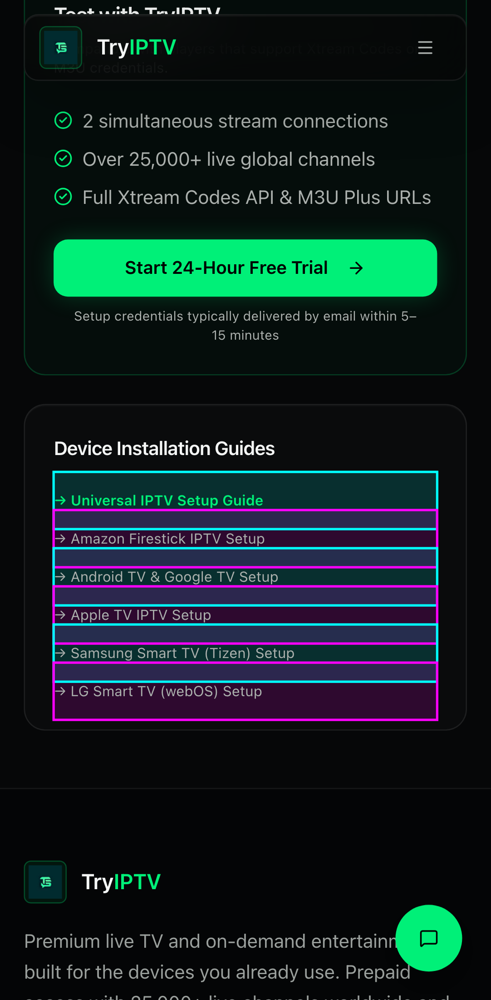 | 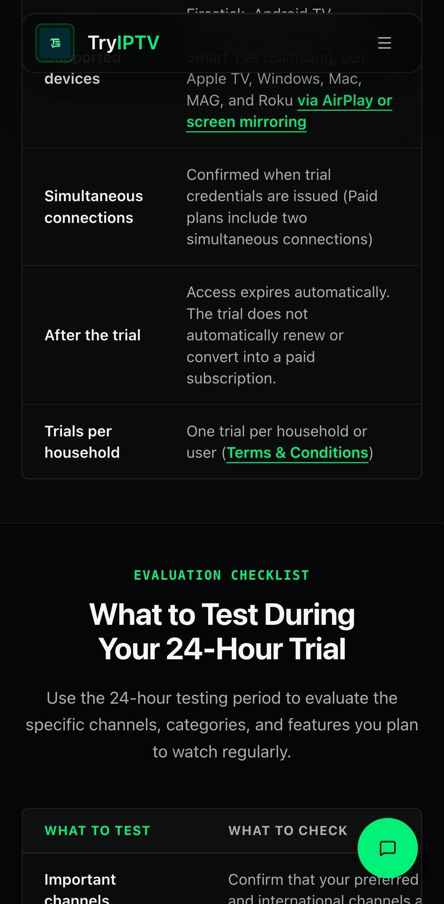 | 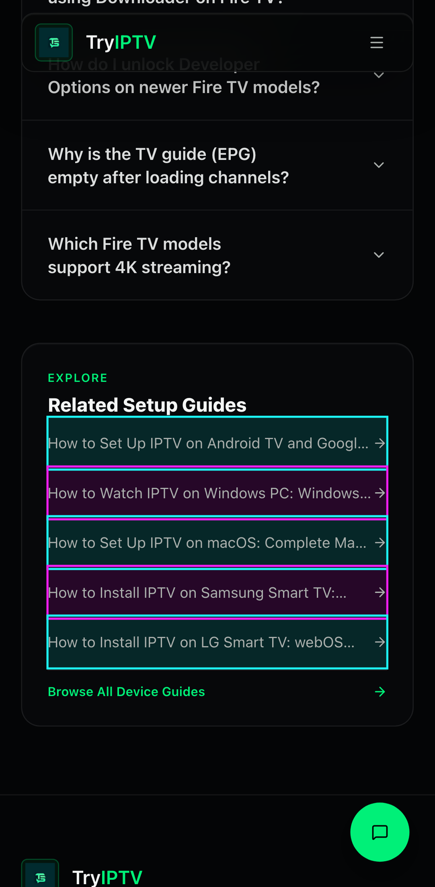 |

  Related list at 375px touch, original → current: 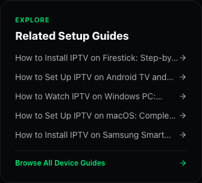 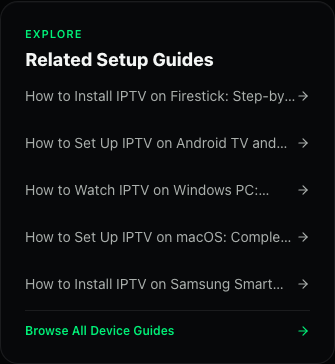

- **Fix:**
  - On stacked or wrapping links, remove `tap-target`.
  - Use the existing Footer pattern instead: `inline-flex min-h-11 items-center … pointer-fine:min-h-0`.
  - Remove the vertical gap on touch only, so rows sit exactly 44px apart with no overlap.
  - Mouse and trackpad layouts return to the original exactly.
  - Not a pure revert, which would drop these targets back below 44px (rule 7). The fix uses only lock values.
  - Isolated `tap-target` uses showed no overlap and no layout change in measurement (27 uses), so they stay.

### R-03 · REGRESSION · Medium · safe-area padding on `body` cuts full-width backgrounds short in landscape
- **Source:** A2-005 (Agent 2's regression 5).
- **Where:** `src/app/globals.css:43-45`, `body { padding-left/right: env(safe-area-inset-*) }`.
- **Measured:** Pixel 7 landscape with emulated 47px insets.
  - Section, hero and footer backgrounds stop 47px short of the screen edges.
  - Content inset becomes 47 + 24 = 71px.
- **Evidence (original → current):** 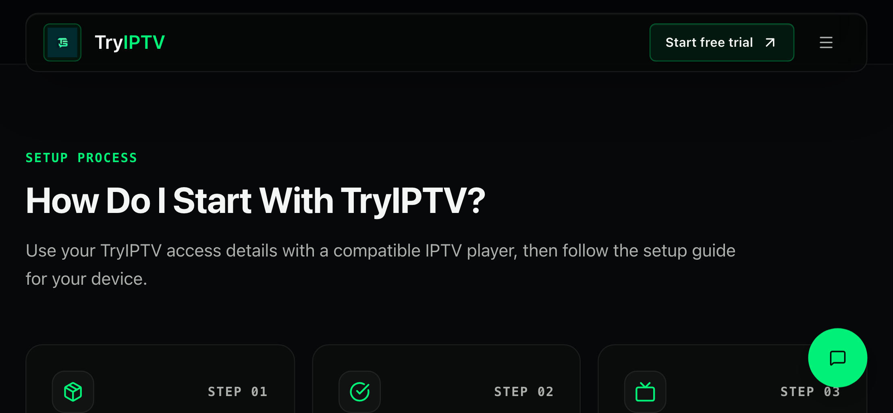 
- **Fix:**
  - Remove the body padding, which reverts the original look.
  - Apply the inset in `src/components/shared/Container.tsx:12` as `max(<existing px-5/px-6/px-8>, env(safe-area-inset-*))`, so backgrounds stay full-bleed and only content clears the notch.
  - Without insets, the values equal the lock's container padding.

### R-04 · REGRESSION · Medium · `/devices` card descriptions hide more text
- **Source:** A2-006 (Agent 2's regression 6).
- **Where:** `src/app/devices/page.tsx:76`, `line-clamp-3` combined with the new 16px text.
- **Measured at 320px:** 4–5 lines hidden per card; the original hid 2–4.
- **Evidence (original → current):** 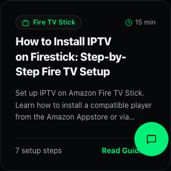 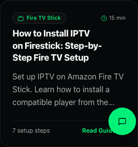
- **Fix:** `sm:line-clamp-3`, which shows the full description below 640px.
  - Reverting the font size would break the approved 16px rule.
  - Showing the full text removes hidden content, so it is clearly better.

### R-05 · REGRESSION · Medium · Breadcrumb spacing uneven and H1 pushed down 28px on touch
- **Source:** A1-003.
- **Where:** `src/components/shared/Breadcrumb.tsx:26,28,36`, where `min-w-11` and `min-h-11` change layout.
- **Measured on `/guides/what-is-epg`:**
  - Separator gaps are 18.7px and 12.6px; originally 8.0px.
  - The trail shifts 7.7px.
  - The nav grows 16 → 44px, pushing the H1 from 197 to 225px.
- **Evidence (original → current):** 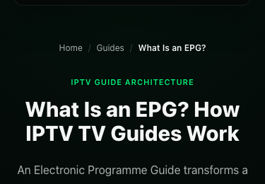 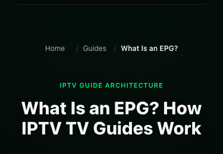
- **Fix: revert the layout and keep the hit area invisibly.**
  - Restore the original `gap-2`.
  - Links get `px-2.5 -mx-2.5`: "FAQ" 27 → 47px wide with no shift, and still no overlap because neighbouring link texts are 21px apart.
  - Keep `min-h-11`, with `-my-3.5 pointer-fine:my-0` on the `<ol>`, so total height is unchanged.

### R-06 · REGRESSION · Medium · Card titles now smaller than their own body text on mobile
- **Source:** A1-004.
- **Where:**

  | Title | Body |
  |---|---|
  | `src/components/guide/GuideRequirements.tsx:73` | `:80` |
  | `src/components/guide/GuideTroubleshooting.tsx:75` | `:80` |
  | `src/components/guide/GuideBufferingChecklist.tsx:76` | `:79` |
  | `src/components/guide/ArticleTermCard.tsx:33` | `:37` |
  | `src/components/guide/GuideCallout.tsx:91` | `:81` |
  | `src/app/iptv-free-trial/page.tsx:555` | `:559` |
  | `src/app/setup/page.tsx:346` | `:350` |

- **Measured on `/devices/firestick-iptv` at 375px:** original h3 14px over p 12px; current h3 14px over p **16px**.
- **Evidence (original → current):** 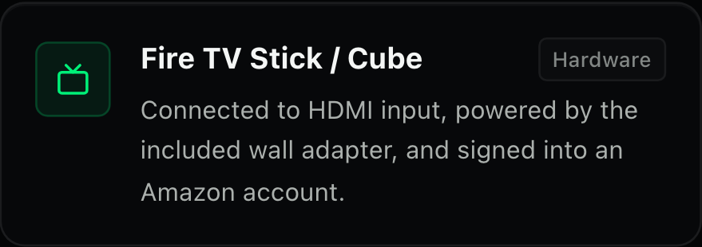 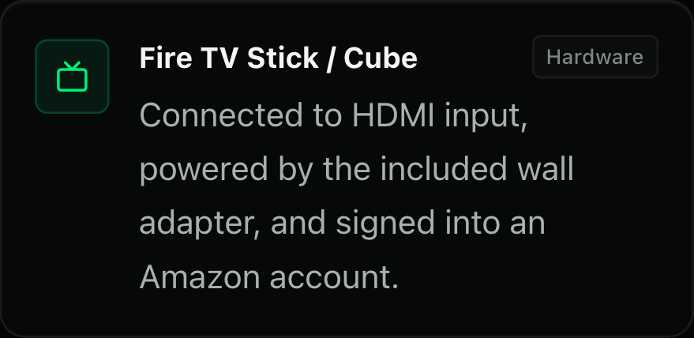
- **Fix:** 16px body is approved, so raise these titles on mobile using lock sizes only:
  - `text-base sm:text-[15px]` for the three Guide* components;
  - `text-base` for ArticleTermCard;
  - `text-base sm:text-sm` for the GuideCallout title and the free-trial `
`.

### R-07 · REGRESSION · Medium · The 16px pass missed some elements, so the same role renders at mixed sizes
- **Source:** A1-005.
- **Where and what was measured:**

  | Where | Measured |
  |---|---|
  | `SectionHeader.tsx:51` subtitle | 15.5px; the FAQ intro (`FAQ.tsx:147`), originally the same size, is now 16px |
  | `contact-us/page.tsx:57` vs `:114` | sibling cards at 14px vs 16px |
  | `setup/page.tsx:370,387,404,421,575,615` | 12px next to 16px paragraphs |
  | Player credential notes: `iptv-extreme:124`, `iptv-smarters:232`, `ott-navigator:250`, `tivimate:234`, `televizo:173`, `xciptv:278`, `perfect-player:98` | 14px |
  | `GuideComparisonTable.tsx:113,138` (mobile cards) | 12px |

- **Fix:** apply the same `text-base sm:<original>` pattern to these elements.

### R-08 · REGRESSION · Medium · Focus outline on in-text links is 46–47px tall on touch devices
- **Source:** A3-001.
- **Where:** `src/app/globals.css:76-81`, the touch padding on class-less in-text links. `.tap-target` has the same side effect on inline links.
- **Measured:** the outline cuts through the lines above and below on 13 routes (iPhone 13 and Pixel 5 emulation).
- **Evidence:** 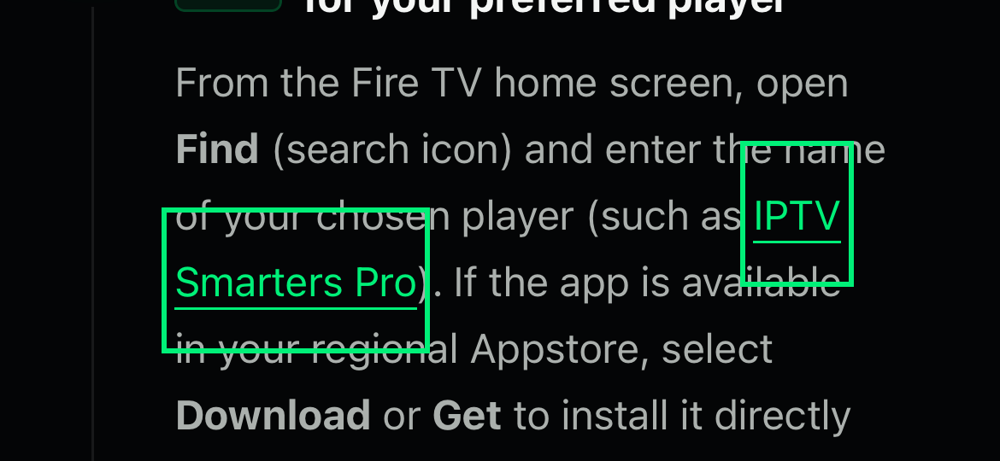 The original had no padding, so its outline hugged the text.
- **Fix:**
  - Revert the padding on class-less in-text links. WCAG 2.5.8 exempts in-text links, and so does the test suite.
  - In `.tap-target`, set both padding and margin to 0 on `:focus-visible`. They cancel each other, so layout doesn't move and the outline hugs the text.

### R-09 · REGRESSION · Low · Footer 38% taller on mobile
- **Source:** A1-006.
- **Where:** `src/components/shared/Footer.tsx:91,131,150,169`.
- **Measured at 375px:**
  - Height 1343.5 → 1856px.
  - Link rows 30 → 46px apart.
  - Bottom padding 32 → 96px.
- **Evidence (original → current):** 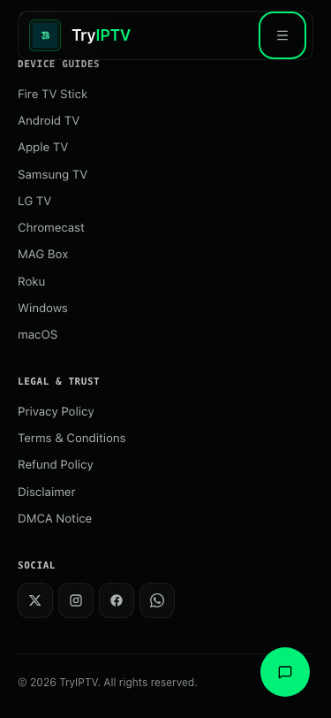 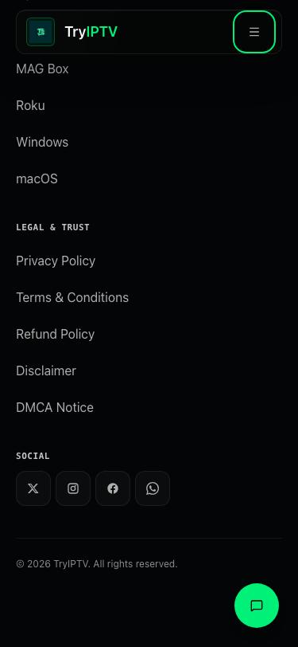
- **Fix:**
  - Footer links are navigation, not body copy, so revert their size to `text-[13.5px]`.
  - Keep the 44px rows on touch (required by rule 7).
  - Keep the bottom padding, which stops the chat button covering the copyright line. The original had that overlap at 390px (A2).

### R-10 · REGRESSION · Low · Sheet close icon moved 6px and its corner radius changed
- **Source:** A1-007.
- **Where:** `src/components/ui/sheet.tsx:69`.
- **Measured:** icon at (343,16) → (337,22); radius 2 → 4px.
- **Evidence (original → current):**  
- **Fix:**
  - Keep the 44×44 button, but offset it by `max(0.125rem, env(safe-area-inset-*))` so the icon returns to exactly (343,16).
  - Restore `rounded-sm`.
  - Keep `data-[state=open]:bg-secondary`. It was in the original, so it is left alone even though it never applies.

### R-11 · REGRESSION · Low · Four different inline-link styles
- **Source:** A1-008.
- **Where:**
  - The new `decoration-primary/40` links (57 places).
  - `linkClass` on the player pages.
  - `src/app/about/page.tsx:37`.
  - Class-less CMS links, `globals.css:71-75`. They use a full-opacity underline.
- **Fix:** apply the approved option A everywhere.
  - Class-less links get `text-decoration-color: hsl(var(--primary) / 0.4)`.
  - Player and about links: any that lack an underline get option A; links that already underline keep their style.
  - The 40% primary step already exists in the lock (`border-primary/40`, §1).

### R-12 · REGRESSION · Low · Inaccurate comments and timing in my earlier code
- **Sources:** A3-011, A3-012.
- **Where and what is wrong:**
  - `src/instrumentation-client.ts:44-49`: the Safari fallback timer runs 2s from script start, not after load as the comment says.
  - `globals.css` `.min-h-viewport`: the comment promises a 100vh fallback, but Lightning CSS drops it because every target browser supports dvh.
- **Fix:**
  - Start the fallback timer on `load`.
  - Correct the comment.

### R-13 · REGRESSION · Low · New Lighthouse `valid-source-maps` failure
- **Source:** A5-008.
- **What:** caused by the lazily loaded Sentry chunk, in 15 of 26 runs. The audit has weight 0, so Best Practices is still 100.
- **Fix:** resolved together with P-02.

---

## 5. Pre-existing findings (present in the original build)

### High

#### P-01 · High · Form error text is nearly unreadable (2.00:1)
- **Source:** A4-001 · WCAG 1.4.3.
- **Where:**
  - `src/components/shared/ContactForm.tsx:55,63,79,86`
  - `src/components/shared/ContactSheet.tsx:92,97,102`
- **Measured:**
  - `text-destructive` (#7f1d1d) on #07080a is **2.00:1**.
  - Inside the error box it is **1.95:1**.
- **Evidence (error text injected into the live form):** 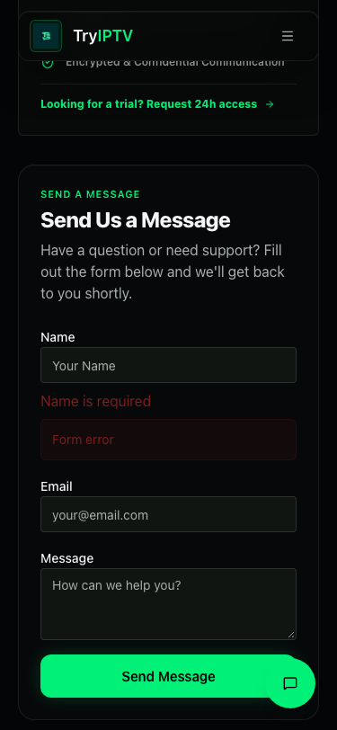
- **Fix:**
  - Error text uses `text-red-400` (#f87171), which is already in the lock (§1, `help/iptv-not-working`). That gives 7.24:1 and 7.05:1.
  - `--destructive` stays as the background token.

#### P-02 · High · Lazy Sentry import still loads the whole SDK
- **Source:** A5-001.
- **Where:** `src/instrumentation-client.ts:18`. `import("@sentry/nextjs")` pulls the full SDK, 546 KB raw / 177 KB gzip, including Replay, rrweb and Feedback, none of which is configured.
- **Measured:**
  - It is the top `unused-javascript` item: 146 KB wasted on `/` mobile.
  - It produces long tasks inside the TBT window on 11 of 13 mobile routes (UNDER LOAD), for example 2.6 s on `/pricing`.
- **Evidence:** `agent5/lh/cur-mobile-*.json` (`unused-javascript`, `long-tasks`). Performance has no screenshot evidence.
- **Pre-existing or regression:** the original evaluated this SDK on the critical path, which was worse. My pass moved it off the critical path, so this is unfinished work, not a regression.
- **Fix:**
  - Dynamic-import a small local module that re-exports only `init` and `captureException`.
  - Verify the chunk shrinks by measuring it. If Turbopack can't tree-shake it, say so and stop there; no config hacks.

### Medium
| ID | Source | Where | Evidence | Fix |
|---|---|---|---|---|
| P-03 | A4-002 · 4.1.2 | `src/components/shared/MobileNav.tsx:22-38` | The mobile menu dialog has no accessible name, and its `<nav>` is unlabelled. Focus trap, Escape and focus return already work. | `<SheetTitle className="sr-only">` (invisible) and `aria-describedby={undefined}` |
| P-04 | A4-003 · 2.4.11 | `src/components/shared/Navbar.tsx:24` sticky header; no `scroll-padding-top` | With Shift+Tab, items end up fully hidden under the 80px header: `/pricing` 10 at 375px (e.g. footer "Terms & Conditions" at top=43), `/iptv-free-trial` 6. 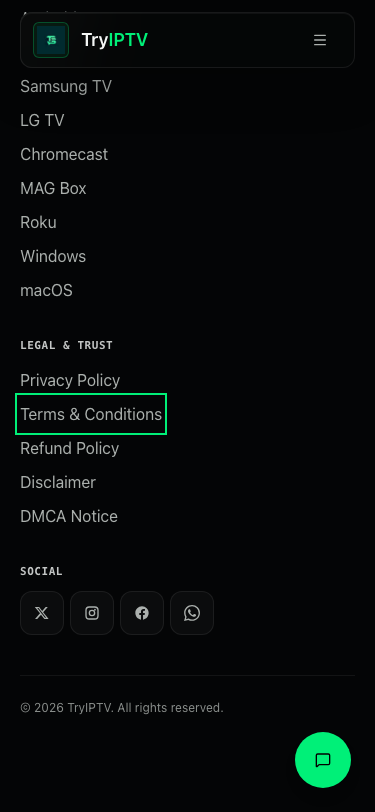 | See disagreement D3: `html{scroll-padding-top:5.5rem}`, and reduce existing `scroll-mt-*` so anchor jumps land where they do today |
| P-05 | A4-004 · 2.1.1 | `ArticleCodeBlock.tsx:32`; `what-are-xtream-codes/page.tsx:389`; `what-is-m3u/page.tsx:436`; `iptv-extreme/page.tsx:65,111`; `iptv-smarters/page.tsx:182`; `ott-navigator/page.tsx:199`; `perfect-player/page.tsx:92`; `xciptv/page.tsx:78,227`; `pricing/page.tsx:275` | axe `scrollable-region-focusable` (serious), 7 nodes: content that scrolls sideways can't be reached by keyboard | `tabIndex={0} role="region" aria-label`, the pattern already used at `iptv-free-trial/page.tsx:230` |
| P-06 | A4-005 · 4.1.3 | `src/components/shared/ContactForm.tsx:49-58` | Success and form-level error messages are plain divs, not announced to screen readers (found by reading the code) | `role="status"` / `role="alert"` |
| P-07 | A5-002 | `src/components/sections/Hero.tsx:68` | The LCP hero image is fetched at Low priority; `lcp-discovery-insight` fails in both builds | `fetchPriority="high"` |
| P-08 | A5-003 | `src/app/layout.tsx:11-12,168-169` | The contact sheet and Toaster load and hydrate on every page (a 74 KB chunk plus 24 KB of Radix Dialog) | Load the sheet's form body when it first opens, and mount the Toaster only on the first toast. The trigger button stays identical |
| P-09 | A3-005 · **UNVERIFIED** | no `:-webkit-autofill` rule in the CSS | Browser autofill may turn the dark inputs light. Playwright can't trigger autofill | **Not acted on** (rule 4), listed for manual testing on a real device |

### Low
| ID | Source | Where | Evidence | Fix |
|---|---|---|---|---|
| P-10 | A1-009 | `players/page.tsx:226`; `devices/[device]/page.tsx:767`; `setup/page.tsx:441`; `guides/m3u-vs-xtream-codes/page.tsx:392` | The same h2 role renders in 3 weight/tracking combinations | Use the lock's "Page h2" pattern |
| P-11 | A1-010 | `pricing/page.tsx:202` | The only uppercase label with no letter-spacing | `tracking-wider` |
| P-12 | A1-011 | `guides/page.tsx:167` | Hub card radius 16px vs 18px on `/players` and `/devices` | Remove the `rounded-2xl` override |
| P-13 | A1-012 | DESIGN_LOCK §1f | `purple-400` and `cyan-400` are used on live pages but missing from the lock | Add them to DESIGN_LOCK (documentation only) |
| P-14 | A1-013 · **owner decision** | `guides/m3u-vs-xtream-codes/page.tsx:214-218`; `help/iptv-not-working/page.tsx:356-360` | The same grid-table issue as what-is-iptv: the header stacks into 3 lines on mobile. 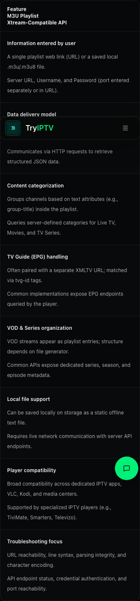 | Extend the approved `data-label` + `::before` pattern? Your call |
| P-15 | A2-008 | firestick screenshots `sizes` | Fetches 1.71× the pixels needed on iPad landscape | Correct the `sizes` breakpoint |
| P-16 | A2-009 | `next.config.js` `deviceSizes` cap 1536 | TiviMate screenshots slightly under-resolved in phone landscape | Leave it; raising the cap costs bandwidth on every page. Report only |
| P-17 | A2-010 | `ContactSheet.tsx:59` fixed button | At rest, covers the device-guide "On This Page" toggle chevron at 360–414, the first `/faq` accordion chevron and the `/contact-us` WhatsApp card. Only the samsung-tv chevron at 390 is newly covered | Bottom padding on those containers on mobile (lock spacing) |
| P-18 | A2-011 | `/devices`, `/setup`, `/players`, `/iptv-free-trial`, homepage device tiles below 640px | A single orphan item in the last grid row | Report only; changing the grid is a layout-pattern change |
| P-19 | A2-012, A4-008 | `InternalLinks.tsx:32-35`; `GuideToc.tsx` | Titles cut off by `line-clamp-1`; the full text is only in a `title` tooltip, which touch users can't see | `line-clamp-2` |
| P-20 | A3-002 | `ui/sheet.tsx`, `ui/accordion.tsx` | Animations ignore `prefers-reduced-motion` (the 500ms slide still runs) | `motion-reduce:animate-none` |
| P-21 | A3-003 | `ContactSheet.tsx:66` `{isOpen && …}` | The sheet's close animation never plays | Report only; changing it affects how the sheet mounts and its state |
| P-22 | A3-004 · **owner decision** | `next.config.js:122` | The CSP Report-Only header has no `report-to`, so it reports nothing | Your call: add an endpoint or leave it |
| P-23 | A3-006 | `ContactForm`/`ContactSheet` honeypot named "company" | Browser autofill may fill it and mark a real user as a bot | `autoComplete="off"` is already set; rename the field to something autofill won't recognise |
| P-24 | A3-007 · **UNVERIFIED** | `Turnstile.tsx` `theme:'auto'` | A light-mode OS may get a white widget on the dark site. Can't render locally without a site key | Not acted on |
| P-25 | A3-008 · **owner decision** | `layout.tsx` viewport `themeColor` light `#ffffff` | Light-mode browsers tint their toolbar white over a dark-only site. The value is recorded in DESIGN_LOCK | Your call |
| P-26 | A3-009 | `GuideCta` button (`whitespace-nowrap`), 3 guide pages | At 320px in all engines, "Start 24-Hour Free Trial" runs 19px into its card's padding  | Let it wrap at 320px only (`max-[359px]:whitespace-normal`) |
| P-28 | A4-006 · 3.3.2 | `ContactForm.tsx:61,68-77,84`; `ContactSheet.tsx:91,96,101` | Required fields aren't marked as required | `required` / `aria-required` |
| P-29 | A4-007 · 1.4.3 | `Breadcrumb.tsx:34` | The "/" separator is 1.71:1 and is read aloud as "slash" | `aria-hidden="true"` (decorative, so no contrast requirement; looks the same) |
| P-30 | A4-009 | `ui/toast.tsx:80` | The toast close button only appears on hover or focus, so it is never visible on touch | `pointer-coarse:opacity-100` |
| P-31 | A4-010 | `iptv-free-trial/page.tsx:197,613`; `thank-you/page.tsx:72`; `Footer.tsx:109,186-192` | These links open a new tab without saying so; the pricing CTAs do announce it | sr-only "(opens in a new tab)", as pricing already does |
| P-32 | A4-011 | `ui/button.tsx:8` `transition-all` | The focus outline animates from 3px black before settling | Exclude `outline` from the transition |
| P-33 | A4-012 | `not-found.tsx` + footer h3 | 404 page only: heading order jumps from h1 to h3 | Report only; changing the footer headings affects every page |
| P-34 | A5-004 | `Logo.tsx` | The logo lazy-loads although it is visible at the top of the page | `loading="eager"` |
| P-37 | A5-007 | `next.config.js` `imageSizes` | Feedback images served at 640px when 417px is needed | Add 480 to `imageSizes` |

`audit/evidence/cta320-side.png` is copied from `agent3/clips`.

### Info (no action)
| ID | Source | Note |
|---|---|---|
| P-27 | A3-010 | At 280px wide, `/` is 297px. The original was forced to 320 (`min-width:320px`), so it scrolled sideways more. Below the target range |
| P-35 | A5-005 | gtag still runs inside the Lighthouse interactivity window. Its deferral was approved; re-measured in verification |
| P-36 | A5-006 · UNVERIFIED | Turnstile moved from `lazyOnload` to `afterInteractive`, and now loads only on form pages. No site key locally, so not measured |
| P-38/39 | A5-009, A5-010, A3-013 | Next's built-in polyfills; CSS +3.8%; WebKit `text-wrap:pretty` makes pages up to 3% taller (a locked rule) |

---

## 6. Where agents disagreed and how I resolved it

| # | Disagreement | Resolution |
|---|---|---|
| D1 | **Severity of the `clamp()` headings:** A1 rated it High, A2 Medium. Separately, your fix-phase instructions say "clamp() for fluid type", which conflicts with DESIGN_LOCK (no clamp sizes). | **High, and revert (R-01).** DESIGN_LOCK is "non-negotiable", any deviation is a rejected change, and you asked for regressions to be reverted where possible. Fluid type can't hit the locked steps exactly. |
| D2 | **How to fix the `tap-target` problems:** A1 suggested making the `<li>` a flex item, which stops the margins merging. A2 suggested the footer's `min-h-11 … pointer-fine:min-h-0` pattern. | **A2's (R-02).** A1's fix restores the layout, but the hit areas still overlap: a 16–22px band opens the wrong link, which is a functional bug. A2's grows rows to 44px on touch only, using lock values, and changes nothing for a mouse. |
| D3 | **Focus hidden under the sticky header:** A4 reports up to 10 hidden focus stops per page. A2 reports 0 of 522 anchor targets hidden. My earlier pass removed `scroll-padding-top` because it stacks with the 19 existing `scroll-mt-*` offsets. | They measured different things: A4 keyboard focus scrolling, A2 `#anchor` jumps. Both are correct. **Fix (P-04):** add `scroll-padding-top:5.5rem`, remove my Section `scroll-mt-20`, and shrink each original `scroll-mt-*` by 5.5rem, so anchor jumps land at exactly the same pixel as today (verified in testing). |
| D4 | **`data-small-print`:** A1-014 calls it a dead marker and suggests removing it. | **Keep.** It is read by the test suite (`tests/responsive.spec.ts`, body-text check) to skip captions you chose to keep small. It is invisible and harmless; not a finding. |
| D5 | **Oversized focus ring on in-text links:** A3 suggested zero padding on `:focus-visible`; reverting is the other option. | **Revert the padding on class-less in-text links** (WCAG 2.5.8 exempts them; so does our test), **and** add A3's override inside `.tap-target` for the remaining isolated links (R-08). |
| D6 | **`/devices` card text:** A2 suggested `sm:line-clamp-3`; reverting the font size is the alternative. | **`sm:line-clamp-3` (R-04).** Reverting would break the approved 16px rule, and showing the full text removes hidden content. |
| D7 | **Pending decisions:** A1-004, A1-005 and A1-008 were written while 16px and the link style were still undecided. | Both are now approved, so they became concrete fixes: R-06, R-07 and R-11 (option A). |
| D8 | **Cut-off titles:** A2-012 reported them as Low with no fix; A4-008 proposed `line-clamp-2`. | Merged into P-19 with A4's fix. |

## 7. Not acted on without your input

| Reason | IDs |
|---|---|
| **UNVERIFIED** (can't be tested here) | P-09 autofill, P-24 Turnstile theme, P-36 Turnstile timing. Also untested anywhere: real iOS/iPadOS Safari, Samsung Internet, screen readers, form submission (forms were never submitted) |
| **Owner decision** | P-14 two more grid tables, P-22 CSP reporting endpoint, P-25 light `theme-color` |
| **Report only** (fixing would change a layout pattern, mount behaviour or every page) | P-16, P-18, P-21, P-33 |

## 8. Source index (agent ID → consolidated ID)

| Agent ID | Consolidated |
|---|---|
| A1-001 | R-01 |
| A1-002 | R-02 |
| A1-003 | R-05 |
| A1-004 | R-06 |
| A1-005 | R-07 |
| A1-006 | R-09 |
| A1-007 | R-10 |
| A1-008 | R-11 |
| A1-009 | P-10 |
| A1-010 | P-11 |
| A1-011 | P-12 |
| A1-012 | P-13 |
| A1-013 | P-14 |
| A1-014 | D4 (no finding) |
| A2-001 … A2-004 | R-02 |
| A2-005 | R-03 |
| A2-006 | R-04 |
| A2-007 | R-01 |
| A2-008 | P-15 |
| A2-009 | P-16 |
| A2-010 | P-17 |
| A2-011 | P-18 |
| A2-012 | P-19 |
| A3-001 | R-08 |
| A3-002 | P-20 |
| A3-003 | P-21 |
| A3-004 | P-22 |
| A3-005 | P-09 |
| A3-006 | P-23 |
| A3-007 | P-24 |
| A3-008 | P-25 |
| A3-009 | P-26 |
| A3-010 | P-27 |
| A3-011, A3-012 | R-12 |
| A3-013 | P-39 |
| A4-001 | P-01 |
| A4-002 | P-03 |
| A4-003 | P-04 |
| A4-004 | P-05 |
| A4-005 | P-06 |
| A4-006 | P-28 |
| A4-007 | P-29 |
| A4-008 | P-19 |
| A4-009 | P-30 |
| A4-010 | P-31 |
| A4-011 | P-32 |
| A4-012 | P-33 |
| A5-001 | P-02 |
| A5-002 | P-07 |
| A5-003 | P-08 |
| A5-004 | P-34 |
| A5-005 | P-35 |
| A5-006 | P-36 |
| A5-007 | P-37 |
| A5-008 | R-13 |
| A5-009, A5-010 | P-38 |
